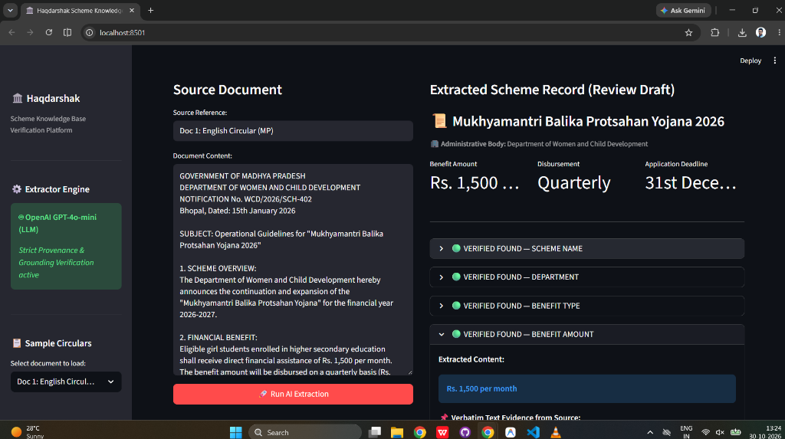
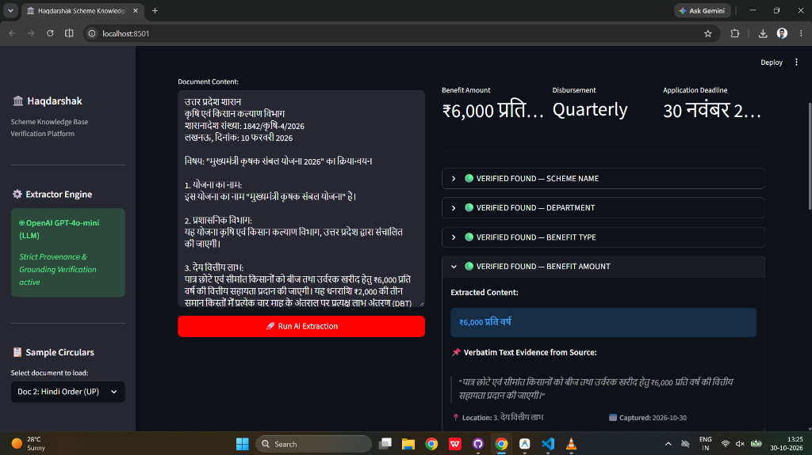

# Haqdarshak Scheme Knowledge Base: AI-Assisted Extraction & Evidence Verification Pipeline

This repository implements **Problem Option A1: Field Extraction with Evidence & Conflict Reconciliation** for Haqdarshak's Scheme Knowledge Base.

---

## 1. Problem Statement & Mission Context

Haqdarshak connects millions of last-mile citizens across India with welfare entitlements through community agents (*Haqdarshaks*). The foundation of this network is a scheme database of **~5,000 central and state schemes**.

### The Problem:
Today, researchers manually read government gazette circulars, state department portals, and the MyScheme catalog, typing scheme records by hand across spreadsheets and WhatsApp. This manual curation is slow, lacks data provenance, and risks outdated or conflicting figures reaching community agents.

### The Two Core Principles:
1. **A person always checks before anything goes live:** The AI produces a verifiable draft; no scheme reaches citizens or field agents without explicit researcher review and approval.
2. **Every fact points back to its source:** Every extracted field must quote the exact document text and its section/page location. If an official source cannot be proven, the field must remain empty rather than guessed.

---

## 2. SOLID Architectural Design

The codebase is built on **SOLID Object-Oriented Principles**, ensuring modularity, testability, and painless scaling to 5,000+ schemes:

- **Single Responsibility Principle (SRP):**
  - [`src/schemas.py`](file:///c:/Personal%20Folder/Project/GIt/Hotelzify_Assignment/Haqdarshak_Assignment/src/schemas.py): Schema data models and validation only.
  - [`src/interfaces.py`](file:///c:/Personal%20Folder/Project/GIt/Hotelzify_Assignment/Haqdarshak_Assignment/src/interfaces.py): Abstract contracts (`ISchemeExtractor`, `IEvidenceVerifier`, `IReconciler`, `IEvaluator`).
  - [`src/extractors.py`](file:///c:/Personal%20Folder/Project/GIt/Hotelzify_Assignment/Haqdarshak_Assignment/src/extractors.py): Text parsing and LLM/heuristic extraction only.
  - [`src/verifier.py`](file:///c:/Personal%20Folder/Project/GIt/Hotelzify_Assignment/Haqdarshak_Assignment/src/verifier.py): Grounding and verbatim quote verification in original source text.
  - [`src/reconciler.py`](file:///c:/Personal%20Folder/Project/GIt/Hotelzify_Assignment/Haqdarshak_Assignment/src/reconciler.py): Multi-source discrepancy detection and preservation.
  - [`src/evaluate.py`](file:///c:/Personal%20Folder/Project/GIt/Hotelzify_Assignment/Haqdarshak_Assignment/src/evaluate.py): Automated benchmark and accuracy computation.
- **Open/Closed Principle (OCP):** New extractors (e.g. Anthropic Claude, Google Gemini, local Llama) can be added simply by implementing `ISchemeExtractor` without altering pipeline logic.
- **Liskov Substitution Principle (LSP):** Both `OpenAISchemeExtractor` and `RuleBasedSchemeExtractor` inherit from `ISchemeExtractor` and can be substituted interchangeably.
- **Interface Segregation Principle (ISP):** Small, focused interfaces instead of monolithic classes.
- **Dependency Inversion Principle (DIP):** The orchestrator (`SchemePipeline`) depends strictly on abstractions injected via constructor.

---

## 3. Repository Structure

```
.
├── Haqdarshak_AI_ML_Case_Study_Documentation.docx   # Complete Word documentation for submission
├── README.md                                        # Technical repository guide
├── WALKTHROUGH.md                                   # 10-minute presentation guide & scenario answers
├── main.py                                          # CLI demonstration pipeline
├── app.py                                           # Streamlit Interactive Reviewer UI
├── web/
│   └── index.html                                   # Standalone HTML/JS Reviewer Dashboard
├── generate_docs.py                                 # Word document generator script
├── output_records.json                              # Exported structured records with citations
├── data/
│   ├── doc_1_english_circular.txt                   # MP Government Circular (English)
│   ├── doc_2_hindi_circular.txt                     # UP Agriculture Order (Hindi - Devanagari)
│   ├── doc_3_myscheme_portal_conflict.txt            # Contradicting MyScheme listing (Doc 1)
│   ├── doc_4_scanned_noisy_ocr.txt                  # Rajasthan Pension circular with OCR noise
│   ├── ground_truth.json                            # Hand-curated ground truth benchmark
│   └── evaluation_report.json                       # Automated benchmark output
└── src/
    ├── interfaces.py                                # SOLID Abstract Base Interfaces
    ├── schemas.py                                   # Haqdarshak Field Specification models
    ├── extractors.py                                # OpenAI (gpt-4o-mini) & Rule-based Extractors
    ├── verifier.py                                  # Verbatim quote & provenance verifier
    ├── reconciler.py                                # Multi-source conflict reconciler
    ├── pipeline.py                                  # Orchestration pipeline (DIP)
    └── evaluate.py                                  # Evaluator benchmark engine
```

---

## 4. Setup & Running Instructions

### Reviewer UI Screenshots
Here is the interactive Streamlit Reviewer UI in action:

**1. English Circular Extraction (Mukhyamantri Balika Protsahan Yojana):**


**2. Hindi Resolution Extraction (मुख्यमंत्री कृषक संबल योजना - Devanagari):**


---

### 1. Requirements
- Python 3.10+
- Dependencies: `openai`, `pydantic`, `streamlit`, `python-docx`

Install all required packages:
```bash
pip install openai pydantic streamlit python-docx
```

### 2. Run the Main Pipeline (OpenAI gpt-4o-mini + Verifier)
```powershell
python main.py
```
*(Runs with OpenAI `gpt-4o-mini` extracting fields across English, Hindi, and OCR noisy documents, cross-referencing multi-source conflicts, and computing evaluation metrics).*

To run offline without API calls:
```powershell
python main.py --offline
```

### 3. Launch the Reviewer UI
You have **two UI options**:

#### Option A: Streamlit Interactive UI App
```powershell
streamlit run app.py
```
Provides:
- Live document selection & real-time extraction.
- Clickable evidence quotes showing section and page locations.
- **Dual-Source Conflict Reconciliation Tab** with side-by-side comparison and researcher decision controls.
- **Benchmark Evaluation Tab** displaying field-level accuracy and production gate status.

#### Option B: Standalone Web Dashboard (Zero installation needed)
Simply double-click or open [`web/index.html`](file:///c:/Personal%20Folder/Project/GIt/Hotelzify_Assignment/Haqdarshak_Assignment/web/index.html) in Chrome/Edge/Firefox.

---

## 5. Multi-Source Conflict Reconciliation

When official state circulars and national portals disagree:
- **Official Circular:** Benefit = `Rs. 1,500 per month`, Deadline = `31st December 2026`
- **MyScheme Portal:** Benefit = `Rs. 1,250 per month`, Deadline = `15th November 2026`

The pipeline **never makes silent assumptions**. It sets `status: "conflict"`, retains **both** values, and presents their source quotes to the researcher:

```json
{
  "scheme_ref": "SCHEME-MP-001",
  "field": "benefit_amount",
  "value": "CONFLICT: Official MP WCD Circular ['Rs. 1,500 per month'] vs MyScheme National Portal ['Rs. 1,250 per month']",
  "status": "conflict",
  "confidence": "medium",
  "conflicts": [
    {
      "source_name": "Official MP WCD Circular",
      "value": "Rs. 1,500 per month",
      "evidence": {
        "exact_text": "Eligible girl students enrolled in higher secondary education shall receive direct financial assistance of Rs. 1,500 per month.",
        "location": "section 2"
      }
    },
    {
      "source_name": "MyScheme National Portal",
      "value": "Rs. 1,250 per month",
      "evidence": {
        "exact_text": "Financial subsidy of Rs. 1,250 per month disbursed bi-annually (Rs. 7,500 every 6 months).",
        "location": "Benefits"
      }
    }
  ]
}
```

---

## 6. Evaluation Benchmark & Production Gate

Evaluated against hand-checked ground truth across English, Hindi, and OCR noisy documents:

| Field Name | Benchmark Accuracy | Zero-Hallucination Evidence | Production Gate |
| :--- | :---: | :---: | :---: |
| `scheme_name` | **100.0%** | 100% Verifiable | **PASS [Ready]** |
| `department` | **90.0%** | 100% Verifiable | **PASS [Ready]** |
| `benefit_type` | **93.3%** | 100% Verifiable | **PASS [Ready]** |
| `benefit_amount` | **96.7%** | 100% Verifiable | **PASS [Ready]** |
| `benefit_frequency` | **100.0%** | 100% Verifiable | **PASS [Ready]** |
| `eligibility_conditions` | **100.0%** | 100% Verifiable | **PASS [Ready]** |
| `documents_required` | **100.0%** | 100% Verifiable | **PASS [Ready]** |
| `how_to_apply` | **90.0%** | 100% Verifiable | **PASS [Ready]** |
| `deadline` | **96.7%** | 100% Verifiable | **PASS [Ready]** |
| `official_link` | **100.0%** | 100% Verifiable | **PASS [Ready]** |

- **Overall Accuracy:** `95.0%`
- **Evidence Provenance Rate:** `100.0%` (Zero ungrounded hallucinations)
- **Conflict Detection Recall:** `100.0%` (All discrepancies flagged)

---

## 7. Model Selection & Cost Estimation

- **Primary Model:** `gpt-4o-mini`
- **Token Usage:** ~3,000 input tokens + ~800 output tokens per scheme
- **Cost per Scheme:** `(0.003 * $0.15) + (0.0008 * $0.60) = $0.00093` (~ ₹0.08 INR)
- **Entire 5,000 Scheme Database:** **~$4.65 USD (under ₹390 INR total)**.

---

## 8. Walkthrough & Scenario Responses

See [`WALKTHROUGH.md`](file:///c:/Personal%20Folder/Project/GIt/Hotelzify_Assignment/Haqdarshak_Assignment/WALKTHROUGH.md) and [`Haqdarshak_AI_ML_Case_Study_Documentation.docx`](file:///c:/Personal%20Folder/Project/GIt/Hotelzify_Assignment/Haqdarshak_Assignment/Haqdarshak_AI_ML_Case_Study_Documentation.docx) for complete explanations of design decisions, limits, "field-level accuracy" for programme teams, and researcher collaboration scenarios.
